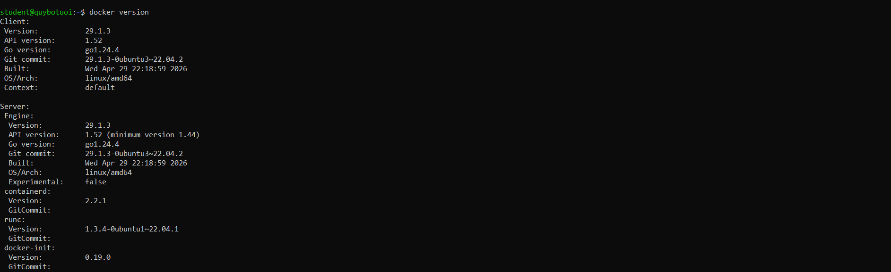
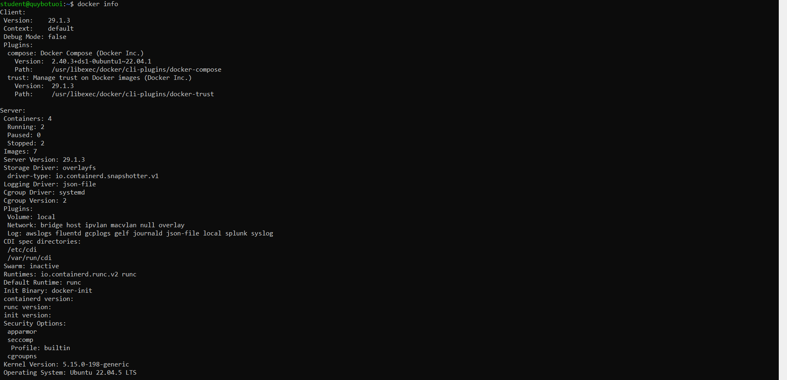

# BÀI 1: CONTAINER VS VIRTUAL MACHINE

## 1. Giới thiệu

Virtual Machine (VM) và Container là hai công nghệ phổ biến trong triển khai ứng dụng. VM sử dụng Hypervisor để tạo các máy ảo có hệ điều hành riêng, còn Container sử dụng chung Kernel của máy chủ thông qua Docker Engine.

Docker giúp doanh nghiệp triển khai ứng dụng nhanh hơn, tiết kiệm tài nguyên và dễ dàng mở rộng. Thay vì cài đặt trực tiếp nhiều ứng dụng lên VPS, doanh nghiệp có thể đóng gói từng ứng dụng vào Container độc lập.

## 2. So sánh VM và Container

| Tiêu chí            | Virtual Machine             | Container                       |
| ------------------- | --------------------------- | ------------------------------- |
| Dung lượng Image    | Lớn, thường vài GB          | Nhỏ hơn, thường MB đến GB       |
| Thời gian khởi động | Hàng chục giây đến vài phút | Thường vài giây hoặc ít hơn     |
| Hao phí OS          | Cao, mỗi VM có OS riêng     | Thấp, dùng chung Kernel         |
| Mức độ cô lập       | Mạnh, Kernel riêng          | Cô lập tiến trình, chung Kernel |
| Khả năng mở rộng    | Tốn nhiều tài nguyên        | Nhanh, dễ nhân bản              |

**Kiến trúc VM:** Hardware → Hypervisor → Guest OS → Application.

**Kiến trúc Container:** Hardware → Host OS → Docker Engine → Container → Application.

VM phù hợp khi cần cô lập mạnh hoặc chạy nhiều hệ điều hành khác nhau. Container phù hợp với Microservices, CI/CD và triển khai ứng dụng linh hoạt.

## 3. Namespaces và Control Groups

### 3.1. Namespaces

Namespaces là cơ chế của Linux Kernel giúp cô lập tài nguyên giữa các Container.

- **PID Namespace:** Cô lập tiến trình, mỗi Container có không gian PID riêng.
- **Network Namespace:** Cô lập địa chỉ IP, giao diện mạng và bảng định tuyến.
- **Mount Namespace:** Cô lập các điểm gắn kết hệ thống tập tin, giúp Container có môi trường thư mục riêng.

Nhờ Namespaces, các Container có thể hoạt động tương đối độc lập trên cùng một máy chủ.

### 3.2. Control Groups (cgroups)

Cgroups giúp giới hạn và quản lý tài nguyên CPU, RAM của Container, tránh việc một ứng dụng chiếm dụng quá nhiều tài nguyên hệ thống.

Ví dụ giới hạn CPU:

```bash
docker run --cpus="1.5" nginx
```

Ví dụ giới hạn RAM:

```bash
docker run --memory="512m" nginx
```

Cgroups giúp tăng tính ổn định, phân phối tài nguyên hợp lý và hỗ trợ vận hành nhiều Container trên một VPS.

## 4. Kiểm tra Docker Engine

Kiểm tra phiên bản Docker:

```bash
docker version
```

Kiểm tra thông tin Docker:

```bash
docker info
```

Lọc thông số cần thiết:

```bash
docker info | grep -E "Server Version|Cgroup Driver|Containers:|Images:"
```

### Kết quả thực tế

| Thông số       | Giá trị              |
| -------------- | -------------------- |
| Server Version | Điền kết quả thực tế |
| Cgroup Driver  | Điền kết quả thực tế |
| Containers     | Điền kết quả thực tế |
| Images         | Điền kết quả thực tế |

Các lệnh được kiểm tra bằng user thường, không sử dụng sudo.

### Ảnh kết quả docker info





## 5. Lợi ích của Docker đối với doanh nghiệp

Docker giúp doanh nghiệp tiết kiệm CPU, RAM và dung lượng lưu trữ so với việc triển khai mỗi ứng dụng trên một VM riêng. Container khởi động nhanh, dễ đóng gói, di chuyển và triển khai đồng nhất giữa các môi trường.

Ngoài ra, Docker hỗ trợ tự động hóa CI/CD, giảm xung đột thư viện và giúp mở rộng hệ thống thuận tiện hơn. Tuy nhiên, Docker không thay thế hoàn toàn VPS hoặc VM mà thường được cài đặt trên các máy chủ này để quản lý ứng dụng hiệu quả.

## 6. Kết luận

VM có ưu điểm về mức độ cô lập, còn Container nổi bật về tốc độ và hiệu quả sử dụng tài nguyên. Namespaces giúp cô lập môi trường, trong khi cgroups quản lý CPU và RAM. Việc kết hợp VPS với Docker là giải pháp phù hợp cho triển khai ứng dụng hiện đại.
